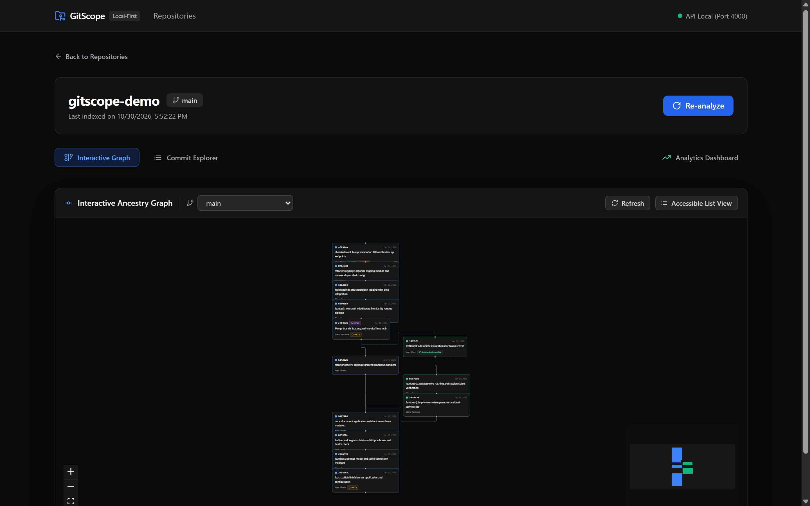
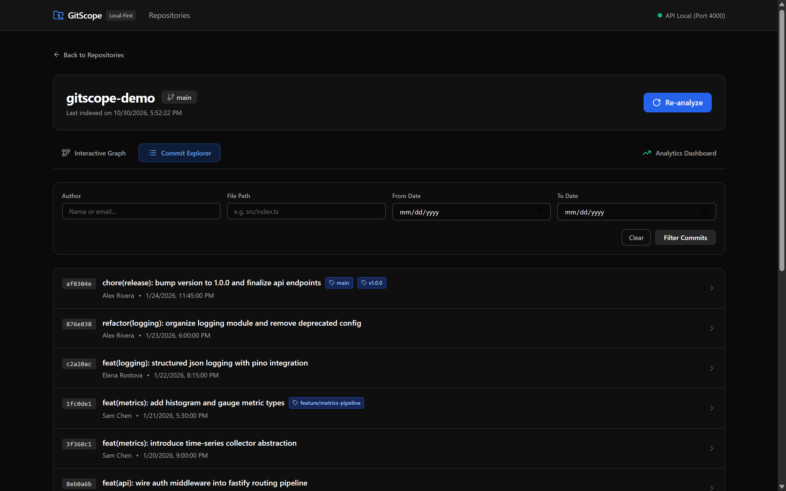
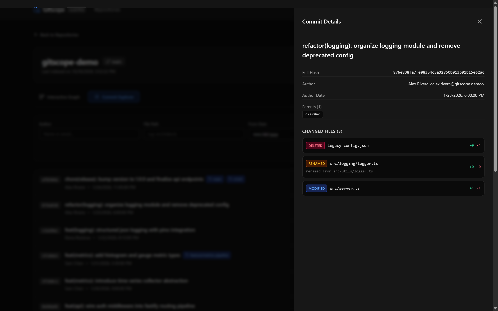
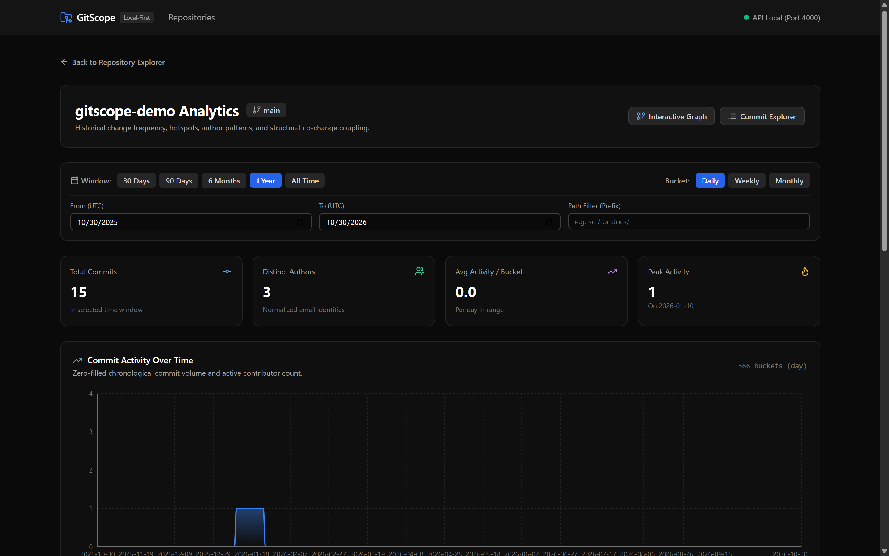
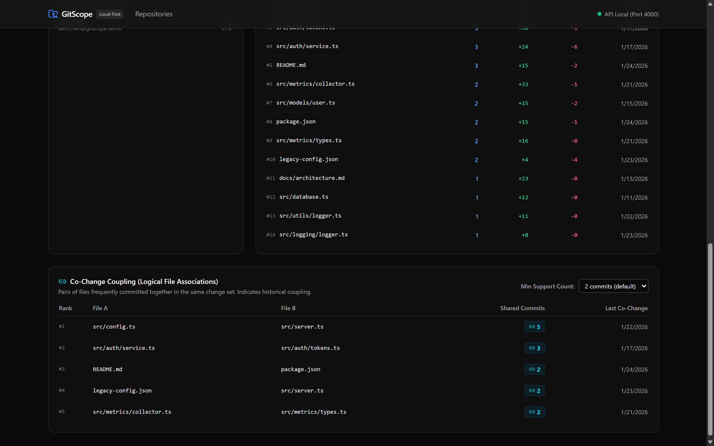
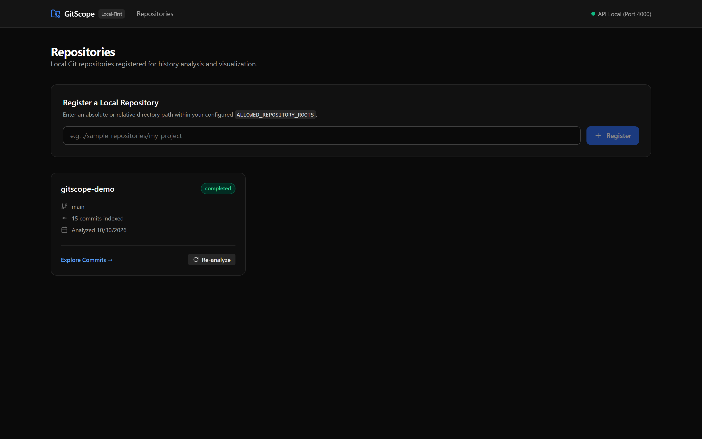
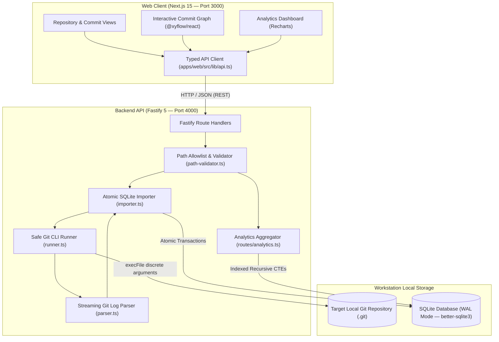

# GitScope

Local-first Git repository analytics with interactive commit graphs, contributor insights, and codebase coupling detection.

[](https://github.com/Justinianus2001/gitscope)
[](https://www.typescriptlang.org/)
[](https://nextjs.org/)
[](https://react.dev/)
[](https://fastify.dev/)
[](https://sqlite.org/)
[](https://vitest.dev/)
[](https://pnpm.io/)

---

## Visual Tour & Interface

### 1. Interactive Commit Ancestry Graph

Bounded topological DAG canvas powered by `@xyflow/react` (`ReactFlow`), featuring deterministic branch lane assignments, multi-parent merge indicators, release tag pills, an interactive MiniMap, and fluid pan/zoom navigation:



### 2. Accessible Commit Explorer

Tabular commit history browser with real-time filtering (author, file path, date ranges) and cursor pagination. Supports full keyboard navigation with predictable focus management:



### 3. Slide-Over Commit Detail Drawer

Slide-over inspection drawer displaying commit metadata, parent hashes, ref tags, and per-file addition/deletion metrics with rename tracking. Implements modal focus trapping, `Escape` key dismissal, and focus restoration to the triggering row:



### 4. Contributor Activity Analytics & Leaderboard

Chronological commit frequency and contributor volume visualizer powered by Recharts, featuring contiguous zero-filled UTC time buckets (`day`, `week`, `month`) and an identity-normalized contributor leaderboard:



### 5. Architectural Co-Change Coupling & Churn Hotspots

Data-mined file co-change relationships and modification hotspots, uncovering implicit architectural dependencies and maintenance risk areas without arbitrary file coupling limits:



### 6. Repository Dashboard & Status Polling

Clean repository management interface displaying registered repositories, default branches, commit counts, and reactive ingestion status polling:



---

## Problem & Solution

### The Challenge of Large Git Repositories

Modern software systems evolve through non-linear branch topologies, frequent merges, and distributed contributor teams. Understanding this history with standard Git CLI commands (`git log`, `git blame`, `git shortlog`) presents significant friction:

- **Topology blindness:** Intertwined feature branches, divergent histories, and merge sequences are difficult to parse in a flat terminal stream.
- **Hidden architectural coupling:** Files that frequently change together in the same commits (logical co-change) signal implicit dependencies or modularity issues, but Git CLI lacks built-in primitives to detect them.
- **Code churn hotspots:** Identifying modules undergoing the highest rate of churn requires writing bespoke shell parsing scripts.
- **Privacy & security constraints:** Commercial repository analytics SaaS platforms require uploading proprietary source code and commit histories to third-party clouds, conflicting with enterprise IP boundaries and compliance policies.

### The GitScope Solution

GitScope transforms local Git repositories into actionable architectural intelligence directly on the developer's workstation:

- **Local-First Architecture:** Operates in-process using an embedded SQLite database in WAL mode. Designed for offline workstation use without remote cloud infrastructure, telemetry reporting, or external AI/LLM API dependencies.
- **Relational Metadata Indexing:** Parses and ingests commits, parents, refs, and file-level diff statistics into normalized, indexed relational tables.
- **High-Performance Interactive Visualizations:** Provides sub-10ms query execution across repositories with tens of thousands of commits via optimized SQL recursive CTEs.

---

## Key Features

- **Local Repository Management:**
  - Strict filesystem sandboxing against `ALLOWED_REPOSITORY_ROOTS` to prevent directory traversal and symlink escapes.
  - Idempotent registration and re-analysis.
  - Real-time status polling for background analysis jobs.
- **Interactive Commit Ancestry Graph:**
  - Bounded topological DAG visualization powered by `@xyflow/react` (`ReactFlow`).
  - Deterministic lane assignment, branch tracking, merge commit indicators, and release tag badges.
  - Interactive MiniMap, viewport zoom/pan controls, and ref selector (switch between default branch, feature branches, and tags).
- **Accessible Commit Explorer:**
  - Fast, tabular commit browser with real-time author, file path, and UTC date-range filtering.
  - Stable, cursor-based pagination with deterministic tie-breaking.
  - Slide-over commit inspection drawer detailing commit message body, parent hashes, ref tags, and per-file addition/deletion metrics.
  - Full keyboard accessibility with focus trapping, `Escape` key dismissal, backdrop dismissal, and focus restoration to the triggering row.
- **Contributor Activity Analytics:**
  - Interactive area chart visualizing commit frequency and active contributor volume over time.
  - Contiguous, zero-filled UTC time buckets (`day`, `week`, `month`) powered by Recharts.
  - Contributor leaderboard with normalized email identities (`LOWER(TRIM(email))`) and commit share percentages.
- **Code Churn Hotspots:**
  - Identifies the most frequently modified modules in the repository.
  - Ranks files by distinct modifying commits, lines added, lines deleted, and last modification timestamp.
- **Co-Change Coupling Mining:**
  - Uncovers architectural dependencies by identifying pairs of files committed together across multiple independent changes.
  - Configurable minimum support threshold ($\ge 2$ commits).
  - Combinatorial safety ceiling: bulk commits touching over 200 files (`COCHANGE_MAX_FILES_PER_COMMIT`) are excluded from quadratic pairing to prevent CPU/memory spikes.
- **Reliable Local Storage:**
  - Embedded SQLite storage engine (`better-sqlite3`) configured with write-ahead logging (WAL) and strict foreign key cascades.
  - Atomic transactional import pipeline that cleans previous sync data idempotently.

---

## Architecture Overview



---

## Technology Stack

| Layer                   | Technology           | Version    | Purpose                                                         |
| ----------------------- | -------------------- | ---------- | --------------------------------------------------------------- |
| **Monorepo**            | `pnpm` workspaces    | `10.x`     | Multi-package workspace management                              |
| **Language**            | TypeScript           | `^5.8.2`   | Strict-mode type safety across all packages                     |
| **Frontend Framework**  | Next.js (App Router) | `^15.2.1`  | Server and client component rendering                           |
| **UI Library**          | React                | `^19.0.0`  | Reactive component architecture                                 |
| **Styling**             | Tailwind CSS         | `^3.4.17`  | Consistent dark-theme design system (`neutral-*`)               |
| **Graph Visualization** | `@xyflow/react`      | `^12.12.0` | Interactive commit ancestry DAG canvas                          |
| **Charts**              | Recharts             | `^3.10.1`  | Time-series commit activity visualization                       |
| **Icons**               | Lucide React         | `^0.475.0` | Accessible vector iconography                                   |
| **Backend API**         | Fastify              | `^5.2.1`   | High-throughput local REST API                                  |
| **Persistence**         | `better-sqlite3`     | `^11.8.1`  | Embedded synchronous SQLite storage engine in WAL mode          |
| **Schema Validation**   | Zod                  | `^3.24.2`  | Shared DTO and request parameter validation                     |
| **Testing**             | Vitest               | `^3.0.7`   | Monorepo test runner (174 automated tests across 22 test files) |

---

## Quick Start

### 1. Prerequisites

- **Node.js**: `>= 20.0.0` (tested on Node.js `v22.22.1`)
- **pnpm**: `>= 9.0.0` (tested on pnpm `10.32.1`)
- **Git CLI**: Available in system `PATH` (`git --version`)

> [!NOTE]
> On Windows PowerShell, if running `.ps1` scripts is restricted by execution policy, invoke pnpm using `pnpm.cmd` (e.g. `pnpm.cmd install`).

### 2. Clone and Install

```bash
git clone https://github.com/Justinianus2001/gitscope.git
cd gitscope
pnpm install
```

### 3. Configure Environment

Copy the example environment template:

```bash
# macOS / Linux
cp .env.example .env

# Windows PowerShell
Copy-Item .env.example .env
```

The default configuration is ready for local development:

```ini
NODE_ENV=development
API_HOST=127.0.0.1
API_PORT=4000
WEB_PORT=3000
DATABASE_PATH=./data/gitscope.sqlite
ALLOWED_REPOSITORY_ROOTS=./sample-repositories
GIT_COMMAND_TIMEOUT_MS=30000
MAX_GIT_OUTPUT_BYTES=50000000
COCHANGE_MAX_FILES_PER_COMMIT=200
NEXT_PUBLIC_API_URL=http://127.0.0.1:4000
```

### 4. Setup Deterministic Demo Repository

GitScope provides an automated fixture generator that constructs a realistic multi-branch Git repository:

```bash
pnpm demo:setup
```

### 5. Start Development Servers

Open two terminal sessions:

**Terminal 1: Backend API (port 4000)**

```bash
pnpm dev:api
```

**Terminal 2: Frontend Web (port 3000)**

```bash
pnpm dev:web
```

### 6. Explore the Application

1. Open **`http://localhost:3000`** in your browser.
2. Under **Register a Local Repository**, enter:
   ```text
   ./sample-repositories/gitscope-demo
   ```
3. Click **Register**. Status polling will track background ingestion (`queued` $\to$ `running` $\to$ `completed`).
4. Click **Explore Commits &rarr;** to open the interactive ancestry graph, commit explorer, and analytics dashboard.

---

## Demo Repository Fixture

The deterministic fixture script (`scripts/setup-demo-repo.js`) creates a fully featured Git repository under `./sample-repositories/gitscope-demo`:

- **Commit History:** 15 commits authored across 3 contributor identities.
- **Topology:** Main trunk, divergent feature branches (`feature/auth-service`, `feature/metrics-pipeline`), and merge commits.
- **Release Tags:** Annotated tags `v0.1.0`, `v0.2.0`, and `v1.0.0`.
- **File Changes:** Added, modified, deleted, and renamed files (`src/utils/logger.ts` $\to$ `src/utils/telemetry.ts`).
- **Idempotency:** Safe and non-destructive. If the fixture already exists, the script detects the existing repository and reports its status without overwriting user data.

---

## Performance & Scalability Benchmarks

All benchmarks were empirically measured on Windows 11 Enterprise x64 (NTFS, Node.js v22.22.1, SQLite runtime 3.49.2 via `better-sqlite3` as the measured benchmark environment; driver-bundled SQLite versions may vary across installations). For complete query execution plans, see [docs/benchmark.md](docs/benchmark.md).

### Measured Operation Latencies Across Scales

| Operation                                  | Baseline (31 Commits) | Small (100 Commits) | Medium (500 Commits) | Large (1,000 Commits) | Very Large (10,000 Commits) | Target SLA |
| ------------------------------------------ | :-------------------: | :-----------------: | :------------------: | :-------------------: | :-------------------------: | :--------: |
| **Database Disk Footprint**                |        ~180 KB        |      418.3 KB       |        1.0 MB        |        1.3 MB         |           22.4 MB           |  Bounded   |
| **Cold Initial Import**                    |       188.95 ms       |      186.53 ms      |      559.91 ms       |       194.54 ms       |          879.57 ms          | < 5,000 ms |
| **No-op Re-import**                        |       182.10 ms       |      178.62 ms      |      517.37 ms       |       185.09 ms       |         1,086.23 ms         | < 2,000 ms |
| **Incremental Import (+5 commits)**        |       210.40 ms       |      190.50 ms      |      558.80 ms       |       179.07 ms       |         1,005.75 ms         | < 2,000 ms |
| **History Rewrite / Reset Re-import**      |       195.80 ms       |      173.67 ms      |      557.35 ms       |       206.48 ms       |         1,187.40 ms         | < 2,000 ms |
| **Commit Pagination (Median)**             |        1.85 ms        |       3.50 ms       |       2.85 ms        |        2.66 ms        |           2.16 ms           |  < 50 ms   |
| **File History (Median)**                  |        0.82 ms        |       0.54 ms       |       1.03 ms        |        0.67 ms        |           3.71 ms           |  < 50 ms   |
| **Commit Graph Ancestry (Optimized)**      |        2.50 ms        |       2.21 ms       |       4.80 ms        |        6.15 ms        |        **48.31 ms**         |  < 100 ms  |
| _Commit Graph Ancestry (Pre-Optimization)_ |       _3.10 ms_       |      _2.94 ms_      |      _64.74 ms_      |      _268.14 ms_      |       _32,275.05 ms_        | _< 100 ms_ |
| **Activity Aggregation (Median)**          |        2.30 ms        |       0.77 ms       |       1.94 ms        |        0.81 ms        |           0.41 ms           |  < 50 ms   |
| **Hotspots Ranking (Median)**              |        1.95 ms        |       0.88 ms       |       1.64 ms        |        1.93 ms        |          22.05 ms           |  < 50 ms   |
| **Co-Change Mining (Median)**              |        2.72 ms        |       1.99 ms       |       6.04 ms        |        5.92 ms        |          65.54 ms           |  < 50 ms   |

> [!NOTE]
> **Commit Graph Query Optimization (10,000-Commit Benchmark):**
> On a synthetic linear history fixture of 10,000 commits (Windows 11 x64, NTFS, Node.js v22.22.1, SQLite WAL via `better-sqlite3`), SQLite's default join ordering evaluated `commit_parents` before filtering by `ancestry.hash`. This caused $O(D \times N) \approx O(N^2)$ row scans and an API response latency of **32,275.05 ms** (raw SQL: 31,995.80 ms).
>
> By enforcing `FROM ancestry a CROSS JOIN commit_parents cp`, SQLite is forced to drive the recursive step from `ancestry a` into `commit_parents cp`, performing $O(\log N)$ point lookups in the composite primary key B-tree index `sqlite_autoindex_commit_parents_1 (repo_id, commit_hash, parent_index)`. Under the tested query plan on linear ancestry chains of depth $D$, this traversal model executes in $O(D \log N)$ time (or $O(N \log N)$ for full linear ancestry). This represents an indexed ancestry traversal model under the verified query plan, rather than a universal guarantee for every arbitrary Git DAG (where multi-parent merges and complex branching topologies can increase edge traversals):
>
> - **Raw SQL Execution Time (`better-sqlite3`, warm median of 5 runs):** reduced from 31,995.80 ms to **35.45 ms** (**902.6x raw SQL speedup**; cold run: 36.99 ms).
> - **End-to-End API Response Time (`app.inject`, warm median of 5 runs):** reduced from 32,275.05 ms to **48.31 ms** (**668.1x API response speedup**).

---

## Testing & Quality Assurance

GitScope maintains automated test coverage across all workspace packages:

```bash
# Run the complete test suite (174 automated tests across 22 test files)
pnpm test

# Run TypeScript strict type verification across all packages (tsc --noEmit)
pnpm typecheck

# Run workspace linting scripts (executes tsc --noEmit per workspace)
pnpm lint

# Verify code formatting against Prettier rules
pnpm format:check

# Compile production builds for all packages
pnpm build
```

### Test Suite Structure

- **Unit & Contract Tests:** Validate all Zod DTO schemas, query parameter parsing, date interval math, and layout calculations.
- **Git Importer & Runner Tests:** Verify process spawning, timeout enforcement, signal cancellation, and transactional database ingestion.
- **API Integration Tests:** Exercise all REST endpoints via Fastify route injection (`app.inject`), covering success flows, invalid payloads, and error codes.
- **Security & Sandboxing Tests:** Verify path traversal defense, symlink boundary escape rejection, error message sanitization, and parameterized query safety.
- **Scalability Benchmarks:** Validate execution latencies and memory usage across synthetic repositories ranging from 100 to 10,000 commits.
- **UX & State Tests:** Verify client-side query generation, date presets, focus trapping, and modal navigation.

---

## Security & Privacy Design

1. **Local-First Boundary:** GitScope runs locally and binds strictly to `127.0.0.1`. It connects to no external networks, transmits no telemetry, and requires no cloud authentication or tokens.
2. **Path Sandboxing:** All target repository paths are validated against `ALLOWED_REPOSITORY_ROOTS`. Paths are canonicalized via `fs.realpathSync.native()` to defeat directory traversal (`../`), symlink escapes, and Windows 8.3 short-name bypasses.
3. **Safe Process Invocation:** Git operations execute exclusively via `child_process.execFile` with discrete argument arrays. Shell interpretation (`child_process.exec`, `{ shell: true }`) is prohibited.
4. **Information Disclosure Prevention:** Sensitive host filesystem paths matching the target repository are sanitized to `[repo_root]` in all error responses and logs.
5. **Zero Dynamic SQL:** All database statements use parameterized placeholders (`?`). String concatenation into SQL queries is prohibited.
6. **Combinatorial Safety Limits:** Co-change mining enforces `COCHANGE_MAX_FILES_PER_COMMIT` (default: 200) to protect against quadratic pair explosion from large bulk commits.

For complete threat modeling and mitigation proofs, see [docs/security.md](docs/security.md).

---

## Known Limitations & Roadmap

### Current Limitations

- **Bounded Graph Depth:** The commit graph visualizer bounds ancestry retrieval to 300 commits per ref to prevent browser WebGL/DOM rendering degradation on massive histories. The full commit log remains accessible through the Commit Explorer.
- **Single-User Workstation Tool:** GitScope is designed as an engineer's personal diagnostic workstation application; it does not include multi-tenant user accounts, team permissions, or RBAC.
- **Full History Re-Sync:** Re-running analysis currently re-syncs the full commit history idempotently rather than performing an early-exit HEAD hash comparison.
- **Windows Process Creation Overhead:** Spawning individual Git CLI processes on Windows NTFS incurs ~120ms OS overhead per process. Synthetic test fixtures at scale are generated via `git fast-import` to avoid process-spawn bottlenecks during benchmarks.

### Planned Roadmap

- [ ] 1ms pre-flight ref check (`git rev-parse HEAD`) to skip redundant re-analysis when history is unchanged.
- [ ] Virtualized node rendering on the commit graph canvas for unbounded DAG exploration.
- [ ] Export analytics and hotspot reports to JSON, CSV, and Markdown.

---

## Documentation Index

- [Architecture & Data Flow Documentation](docs/architecture.md)
- [Security Model & Threat Hardening](docs/security.md)
- [Step-by-Step Demo Walkthrough Guide](docs/demo.md)
- [Benchmark Methodology & Performance Data](docs/benchmark.md)
- [Mathematical Metrics Definitions](docs/metrics.md)
- [Milestone 7 Audit Report](docs/milestone-7-audit.md)

---

## License

This repository does not currently include a formal open-source license file. An open-source license (such as [MIT](https://opensource.org/license/mit)) may be selected prior to public release.
