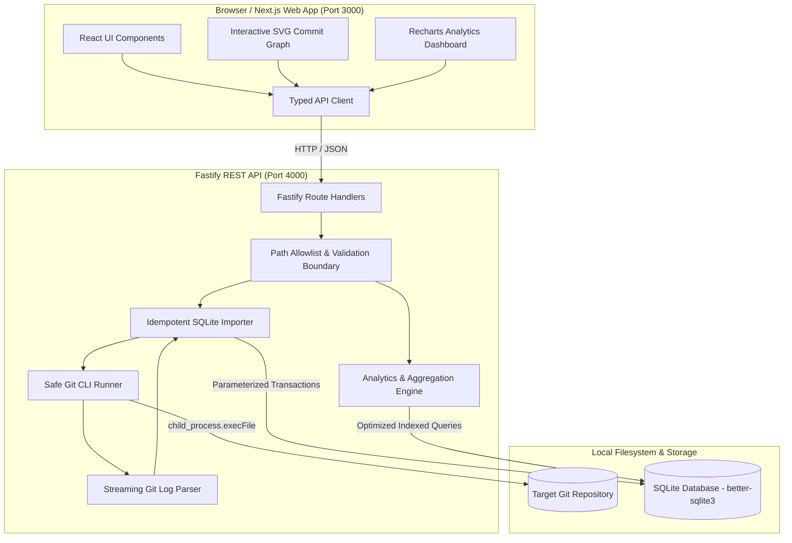
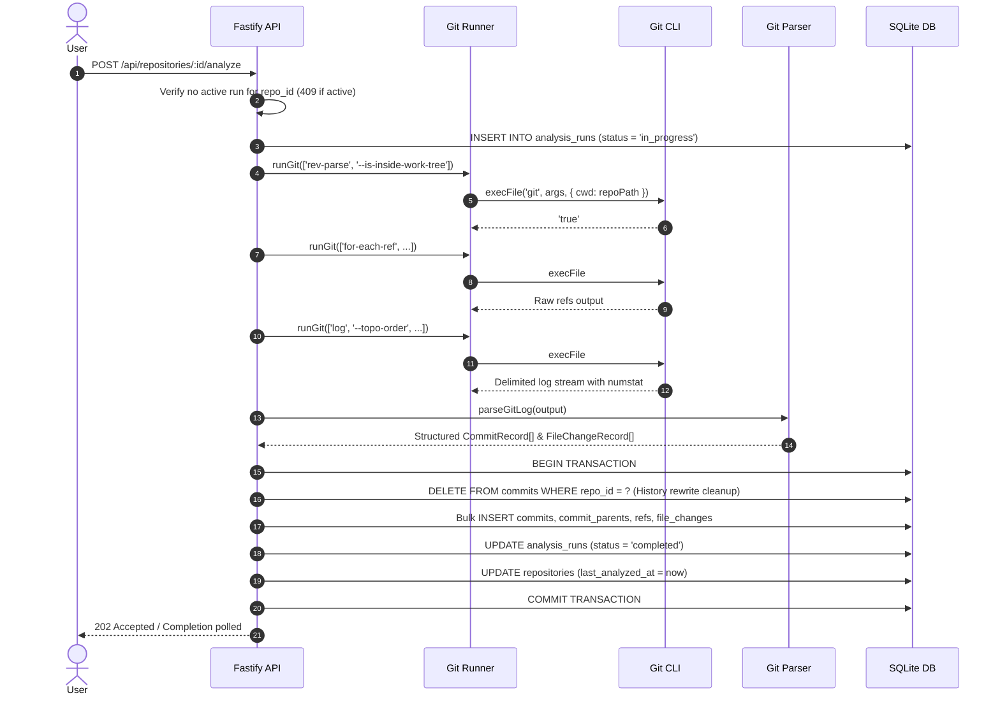
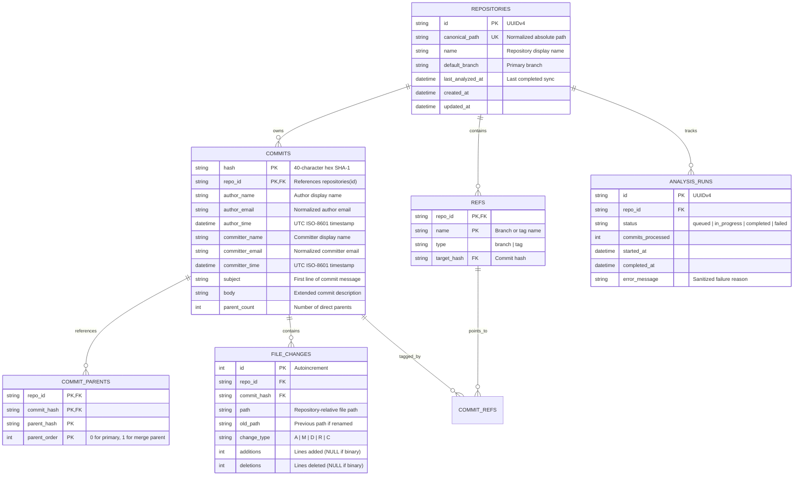

# GitScope Architecture

GitScope is a local-first, privacy-preserving Git repository analytics application. It operates entirely on the developer's local machine without third-party services, cloud dependencies, external telemetry, or AI/LLM components.

---

## 1. System Overview



---

## 2. Monorepo Structure & Module Boundaries

GitScope is organized as a pnpm workspace monorepo enforcing TypeScript strict mode across all packages:

```text
gitscope/
├── apps/
│   ├── api/                     # Fastify 5 REST API & SQLite persistence
│   │   ├── src/
│   │   │   ├── config.ts        # Environment & configuration validation (Zod)
│   │   │   ├── app.ts           # Fastify application factory & error handling
│   │   │   ├── db/              # SQLite connection, migrations & transactions
│   │   │   ├── git/             # Safe runner, streaming parser & importer
│   │   │   ├── routes/          # REST route controllers
│   │   │   └── __tests__/       # Unit, integration, security & benchmark tests
│   └── web/                     # Next.js 15 frontend application
│       ├── src/
│       │   ├── app/             # App Router pages (layout, dashboard, repo views)
│       │   ├── components/      # UI components (graph, activity, hotspots, co-changes)
│       │   └── lib/             # Typed API client & utilities
├── packages/
│   └── shared/                  # Shared TypeScript contracts & Zod DTO schemas
│       └── src/
│           ├── dto/             # Repositories, Commits, Graph, Analytics schemas
│           └── errors/          # Standardized error codes & structures
├── docs/                        # Architecture, security, metrics, benchmarks & plans
├── pnpm-workspace.yaml
├── package.json
└── tsconfig.base.json
```

### Module Responsibilities & Invariants

1. **`@gitscope/shared`**: Contains zero runtime dependencies other than Zod. Defines the single source of truth for all API request parameters, query filters, and response payloads.
2. **`@gitscope/api`**: Owns all Git command execution and database persistence. Never returns raw stack traces or internal host filesystem paths outside the repository root.
3. **`@gitscope/web`**: Purely consumer of `@gitscope/shared` and the REST API. Contains no direct filesystem or Git access.

---

## 3. Ingestion Pipeline

The ingestion pipeline converts raw Git history into relational SQLite tables deterministically and idempotently.



### Safe Process Invocation

- Process execution uses `node:child_process.execFile` with explicit argument arrays.
- Shell interpolation (`child_process.exec`, shell: true) is strictly forbidden.
- Command execution enforces `GIT_COMMAND_TIMEOUT_MS` (default: 30s) and `MAX_GIT_OUTPUT_BYTES` (default: 50MB) to prevent hung processes and memory exhaustion.
- The working directory `options.cwd` is explicitly pinned to the validated repository path.

### Idempotency & History Rewrites

- Imports are atomic: all writes occur within a single SQLite transaction.
- When re-analyzing a repository that underwent a `git reset`, `git rebase`, or force push, unreachable commits are pruned by clearing existing commit records for that `repo_id` before inserting the updated topological commit graph.
- If an import fails or is aborted, the entire transaction rolls back cleanly, leaving previously indexed data intact.

---

## 4. SQLite Storage Engine

GitScope uses `better-sqlite3` operating synchronously in-process.

### Core Pragmas

```sql
PRAGMA journal_mode = WAL;
PRAGMA synchronous = NORMAL;
PRAGMA foreign_keys = ON;
PRAGMA temp_store = MEMORY;
PRAGMA cache_size = -64000; -- 64MB memory cache
```

### Relational Schema



### Multi-Index Strategy

To maintain sub-10ms query execution across 10,000+ commit repositories:

- `idx_commits_repo_time_hash`: `(repo_id, author_time DESC, hash DESC)` — Powers cursor-based pagination.
- `idx_commits_repo_author`: `(repo_id, author_email)` — Powers contributor analytics.
- `idx_file_changes_repo_path`: `(repo_id, path)` — Powers file history and hotspot frequency.
- `idx_file_changes_repo_old_path`: `(repo_id, old_path)` — Enables SQLite `MULTI-INDEX OR` optimization for rename tracking.
- `idx_commit_parents_lookup`: `(repo_id, commit_hash, parent_order)` — Powers DAG ancestry graph extraction.

---

## 5. Query & Analytics Engine

### 1. Cursor-Based Pagination

Pagination avoids `OFFSET` performance degradation. It uses compound keys:

```sql
SELECT ... FROM commits
WHERE repo_id = :repoId
  AND (author_time < :cursorTime OR (author_time = :cursorTime AND hash < :cursorHash))
ORDER BY author_time DESC, hash DESC
LIMIT :limit;
```

Cursors are base64url-encoded JSON tokens `{"t": "2026-10-29T10:00:00.000Z", "h": "hash"}` ensuring stable navigation regardless of concurrent insertions.

### 2. File Rename Tracking

File history queries track renames without full repository re-parsing using SQLite's multi-index union:

```sql
SELECT c.*, fc.change_type, fc.path, fc.old_path, fc.additions, fc.deletions
FROM file_changes fc
JOIN commits c ON c.repo_id = fc.repo_id AND c.hash = fc.commit_hash
WHERE fc.repo_id = :repoId
  AND (fc.path = :targetPath OR fc.old_path = :targetPath)
ORDER BY c.author_time DESC, c.hash DESC
LIMIT :limit;
```

### 3. Interactive Commit DAG

Graph generation retrieves bounded topological ancestry using a recursive CTE starting from the selected ref or HEAD:

```sql
WITH RECURSIVE ancestry(hash, depth) AS (
    SELECT target_hash, 0 FROM refs WHERE repo_id = :repoId AND name = :refName
    UNION
    SELECT cp.parent_hash, a.depth + 1
    FROM ancestry a
    JOIN commit_parents cp ON cp.repo_id = :repoId AND cp.commit_hash = a.hash
    WHERE a.depth < :maxDepth
)
SELECT c.*, GROUP_CONCAT(cp.parent_hash, ',') as parents
FROM ancestry a
JOIN commits c ON c.repo_id = :repoId AND c.hash = a.hash
LEFT JOIN commit_parents cp ON cp.repo_id = :repoId AND cp.commit_hash = c.hash
GROUP BY c.hash
ORDER BY c.author_time DESC;
```

### 4. Co-Change Mining & Combinatorial Safety

Co-change analysis calculates how often pairs of files are modified in the same commit:

- Canonical ordering (`pathA < pathB`) prevents double-counting pairs.
- **Safety Ceiling (`COCHANGE_MAX_FILES_PER_COMMIT = 200`)**: Commits modifying more than 200 files (e.g. bulk formatting, dependency lock updates, vendored imports) would generate $\binom{N}{2} > 20,000$ pairs each, causing CPU and memory spikes. The engine skips pairing for commits exceeding this limit and reports the count in `excludedLargeCommitsCount`.

---

## 6. Frontend Architecture

The web application is built with Next.js 15 (App Router) and React 19:

- **Server & Client Component Separation**: Layouts and shell containers render on the server; interactive graph canvases, metric filter bars, and drawers operate as client components (`'use client'`).
- **Responsive Layout**: Sidebar navigation, sticky commit header with search/filter, multi-column metrics dashboard, and slide-over commit detail drawer.
- **Deterministic Commit Graph Visualizer**: Pure client-side SVG rendering calculating column tracks, branch divergence lanes, and Bezier merge curves without external D3 dependencies.
- **Typed API Client**: Single centralized client (`apps/web/src/lib/api-client.ts`) with custom fetch wrappers, response typing derived from `@gitscope/shared`, and user-friendly error translation.
