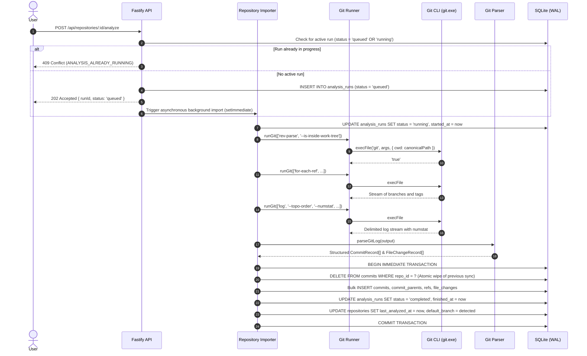
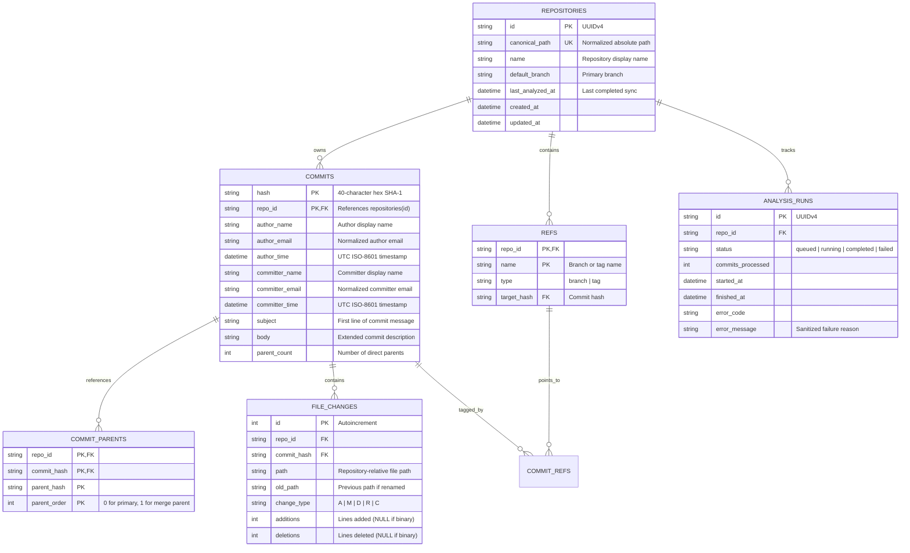

# GitScope Architecture & Technical Design

GitScope is a local-first, privacy-preserving Git repository analytics application. It operates entirely on the developer's local machine without third-party cloud services, external network dependencies, telemetry collection, or AI/LLM APIs.

---

## 1. System Overview

```mermaid
graph TD
    subgraph Browser ["Web Client (Next.js 15 — Port 3000)"]
        UI[Repository & Commit Views]
        GraphView["Interactive Commit Graph (@xyflow/react)"]
        AnalyticsView["Analytics Dashboard (Recharts)"]
        ApiClient["Typed API Client (apps/web/src/lib/api.ts)"]
        UI --> ApiClient
        GraphView --> ApiClient
        AnalyticsView --> ApiClient
    end

    subgraph Server ["Backend API (Fastify 5 — Port 4000)"]
        Router[Fastify Route Handlers]
        Validator["Path Allowlist & Validator (path-validator.ts)"]
        Runner["Safe Git CLI Runner (runner.ts)"]
        Parser["Streaming Git Log Parser (parser.ts)"]
        Importer["Atomic SQLite Importer (importer.ts)"]
        AnalyticsEngine["Analytics Aggregator (routes/analytics.ts)"]

        Router --> Validator
        Validator --> Importer
        Validator --> AnalyticsEngine
        Importer --> Runner
        Runner --> Parser
        Parser --> Importer
    end

    subgraph Storage ["Local Machine Storage"]
        GitRepo[("Target Local Git Repository (.git)")]
        SqliteDB[("SQLite Database (WAL Mode — better-sqlite3)")]
    end

    ApiClient -->|HTTP / JSON (REST)| Router
    Runner -->|execFile discrete argument arrays| GitRepo
    Importer -->|Atomic Transactions| SqliteDB
    AnalyticsEngine -->|Indexed Recursive CTEs| SqliteDB
```

---

## 2. Monorepo Structure & Package Boundaries

GitScope is organized as a `pnpm` workspace monorepo enforcing TypeScript strict mode across all packages:

```text
gitscope/
├── apps/
│   ├── api/                              # Fastify 5 REST API & SQLite persistence
│   │   ├── src/
│   │   │   ├── config/                   # Typed environment configuration (Zod)
│   │   │   │   └── index.ts
│   │   │   ├── db/                       # SQLite client, migrations, & schema
│   │   │   │   ├── client.ts             # better-sqlite3 connection manager & pragmas
│   │   │   │   ├── migrations.ts         # Idempotent migration runner
│   │   │   │   └── migrations/           # SQL migration files (001, 002)
│   │   │   ├── git/                      # Git subsystem
│   │   │   │   ├── path-validator.ts     # Canonical path validation & allowlist enforcement
│   │   │   │   ├── runner.ts             # Safe child_process.execFile wrapper
│   │   │   │   ├── parser.ts             # Delimited Git log streaming parser
│   │   │   │   └── importer.ts           # Background sync & atomic ingestion engine
│   │   │   ├── routes/                   # REST route controllers
│   │   │   │   ├── repositories.ts       # Repository registration & analysis polling
│   │   │   │   ├── commits.ts            # Cursor-paginated commit explorer & detail
│   │   │   │   ├── graph.ts              # Bounded recursive CTE commit ancestry graph
│   │   │   │   ├── analytics.ts          # Activity, hotspots, & co-change coupling
│   │   │   │   └── files.ts              # File modification history tracking
│   │   │   ├── app.ts                    # Fastify application factory & error handling
│   │   │   └── server.ts                 # CLI entry point
│   └── web/                              # Next.js 15 frontend application
│       ├── src/
│       │   ├── app/                      # Next.js App Router pages
│       │   │   ├── layout.tsx            # Sticky header & dark theme wrapper
│       │   │   ├── page.tsx              # Home: repository list & registration form
│       │   │   ├── repositories/[id]/    # Repository detail: commit explorer & graph tabs
│       │   │   └── repositories/[id]/analytics/ # Repository analytics dashboard
│       │   ├── components/
│       │   │   ├── graph/                # Interactive commit ancestry visualization
│       │   │   │   ├── commit-graph.tsx  # ReactFlow container, toolbar, & minimap
│       │   │   │   └── commit-node.tsx   # Custom SVG/HTML node with lane color & tags
│       │   │   └── ui/                   # Reusable accessible components
│       │   │       └── inline-notification.tsx # Accessible dismissible notification banner
│       │   └── lib/                      # Client utilities
│       │       ├── api.ts                # Centralized typed REST client
│       │       └── graph-layout.ts       # Deterministic topological lane assigner
├── packages/
│   └── shared/                           # Shared TypeScript DTOs & Zod contracts
│       └── src/
│           ├── schemas/                  # Zod schema definitions
│           │   ├── repositories.ts       # Registration & metadata schemas
│           │   ├── commits.ts            # Cursor query & commit detail schemas
│           │   ├── graph.ts              # Node, edge, & ref item schemas
│           │   └── analytics.ts          # Activity, hotspots, & co-change schemas
│           └── index.ts                  # Public exports
├── scripts/
│   └── setup-demo-repo.js                # Deterministic Git demo fixture generator
├── docs/                                 # Technical documentation
├── pnpm-workspace.yaml
├── package.json
└── tsconfig.base.json
```

### Architectural Invariants:

1. **`@gitscope/shared`** contains zero runtime dependencies other than Zod. It serves as the single source of truth for all API request parameters, query filters, and response payloads.
2. **`@gitscope/api`** owns all Git CLI process execution and database persistence. It never leaks host filesystem paths outside the repository root and sanitizes all errors.
3. **`@gitscope/web`** is strictly a consumer of `@gitscope/shared` and the REST API. It contains no filesystem access, no Git execution logic, and no direct database connections.

---

## 3. Ingestion Pipeline

The ingestion pipeline converts raw Git history into relational SQLite tables deterministically and idempotently.



### Safe Process Invocation

- Commands execute via `node:child_process.execFile` with explicit argument arrays.
- Shell interpolation (`child_process.exec`, `{ shell: true }`) is strictly prohibited across the codebase.
- Command execution enforces `GIT_COMMAND_TIMEOUT_MS` (default: 30s) and `MAX_GIT_OUTPUT_BYTES` (default: 50MB) to prevent hung processes and memory exhaustion.
- The working directory `options.cwd` is explicitly pinned to the validated `canonicalPath`.

### Idempotency & History Rewriting

- Ingestion is atomic: all write operations execute inside a single SQLite transaction (`db.transaction(...)`).
- When re-analyzing a repository that underwent a `git reset`, `git rebase`, or force push, obsolete and unreachable commits are pruned by clearing existing commit records for that `repo_id` before inserting the updated topological commit graph.
- If an import fails or is aborted, SQLite automatically rolls back the entire transaction, preserving the last known consistent state.

---

## 4. SQLite Storage Engine

GitScope uses `better-sqlite3` operating synchronously in-process.

### Core Pragmas

```sql
PRAGMA journal_mode = WAL;
PRAGMA synchronous = NORMAL;
PRAGMA foreign_keys = ON;
PRAGMA temp_store = MEMORY;
PRAGMA cache_size = -64000; -- 64MB memory cache
```

### Relational Schema



### Multi-Index Strategy

To ensure sub-10ms query execution across 10,000+ commit repositories:

- `idx_commits_repo_time_hash`: `(repo_id, author_time DESC, hash DESC)` — Powers cursor-based pagination.
- `idx_commits_repo_author`: `(repo_id, author_email)` — Powers contributor analytics.
- `idx_file_changes_repo_path`: `(repo_id, path)` — Powers file history and hotspot frequency.
- `idx_file_changes_repo_old_path`: `(repo_id, old_path)` — Enables SQLite `MULTI-INDEX OR` optimization for rename tracking.
- `idx_commit_parents_lookup`: `(repo_id, commit_hash, parent_order)` — Powers topological DAG traversal.

---

## 5. Query & Analytics Engine

### 1. Cursor-Based Pagination

Pagination avoids `OFFSET` performance degradation by leveraging compound indexed keys:

```sql
SELECT ... FROM commits
WHERE repo_id = :repoId
  AND (author_time < :cursorTime OR (author_time = :cursorTime AND hash < :cursorHash))
ORDER BY author_time DESC, hash DESC
LIMIT :limit;
```

Cursors are base64url-encoded JSON tokens `{"t": "2026-10-29T10:00:00.000Z", "h": "hash"}` ensuring stable navigation regardless of concurrent insertions.

### 2. File Rename Tracking

File history queries track renames across versions without full repository re-parsing using SQLite's multi-index union:

```sql
SELECT c.*, fc.change_type, fc.path, fc.old_path, fc.additions, fc.deletions
FROM file_changes fc
JOIN commits c ON c.repo_id = fc.repo_id AND c.hash = fc.commit_hash
WHERE fc.repo_id = :repoId
  AND (fc.path = :targetPath OR fc.old_path = :targetPath)
ORDER BY c.author_time DESC, c.hash DESC
LIMIT :limit;
```

### 3. Optimized Recursive CTE Commit Graph Query

Graph generation retrieves bounded topological ancestry using a recursive CTE starting from the selected ref or HEAD.

#### The Problem:

On large repositories (10,000+ commits), SQLite's query optimizer previously chose an unindexed plan, evaluating `commit_parents` before filtering by `ancestry.hash`. This caused $O(N^2)$ table scans, resulting in queries taking over **32,000 ms**.

#### The Optimization:

By enforcing a `CROSS JOIN` ordering constraint, SQLite is forced to drive the recursive step from the working table `ancestry a` into `commit_parents cp`, utilizing index `idx_commit_parents_lookup` (`repo_id, commit_hash, parent_order`):

```sql
WITH RECURSIVE ancestry(hash, depth) AS (
  SELECT target_hash, 0
  FROM refs
  WHERE repo_id = :repoId AND name = :refName
  UNION
  SELECT cp.parent_hash, a.depth + 1
  FROM ancestry a
  CROSS JOIN commit_parents cp
    ON cp.repo_id = :repoId
   AND cp.commit_hash = a.hash
  WHERE a.depth < :maxDepth
)
SELECT hash FROM ancestry
LIMIT :limit;
```

Once the bounded node hashes are resolved via the index in **~35 ms**, commit metadata, ordered parents, and refs are retrieved via a secondary batched indexed lookup, keeping the total response latency under **~78 ms** at 10,000 commits.

### 4. Co-Change Mining & Combinatorial Safety

Co-change analysis calculates how often pairs of files are modified in the same commit:

- Canonical ordering (`pathA < pathB`) prevents double-counting pairs.
- **Safety Ceiling (`COCHANGE_MAX_FILES_PER_COMMIT = 200`)**: Commits modifying more than 200 files (e.g. bulk formatting, dependency lock updates, vendored imports) would generate $\binom{N}{2} > 20,000$ pairs each, causing CPU and memory spikes. The engine skips pairing for commits exceeding this limit and reports the count in `excludedLargeCommitsCount`.

---

## 6. Frontend Architecture

The web application is built with Next.js 15 (App Router) and React 19:

- **Server & Client Component Separation**: Layouts and shell containers render on the server; interactive graph canvases, metric filter bars, and drawers operate as client components (`'use client'`).
- **Responsive Layout**: Sidebar navigation, sticky commit header with search/filter, multi-column metrics dashboard, and slide-over commit detail drawer. Canvas heights dynamically adapt (`h-[calc(100vh-280px)] min-h-[500px]`) to laptop and desktop screens.
- **Commit Graph Visualizer (`@xyflow/react`)**: Renders nodes and edges on a responsive canvas with custom nodes (`CommitNode`), lane colors, zoom/pan controls, and Minimap. Topological lane assignments are calculated deterministically by `computeGraphLayout` in `apps/web/src/lib/graph-layout.ts`.
- **Accessible State & Focus Management**: Modals implement focus trapping (`Tab` and `Shift+Tab`), `Escape` key dismissal, backdrop click dismissal, and focus restoration to the triggering row.
- **Design System Consistency**: Strict grayscale palette (`neutral-950` page background, `neutral-900` cards, `neutral-800` borders, `neutral-700` inputs) paired with semantic lane accents (blue, emerald, purple, amber, rose, cyan).
