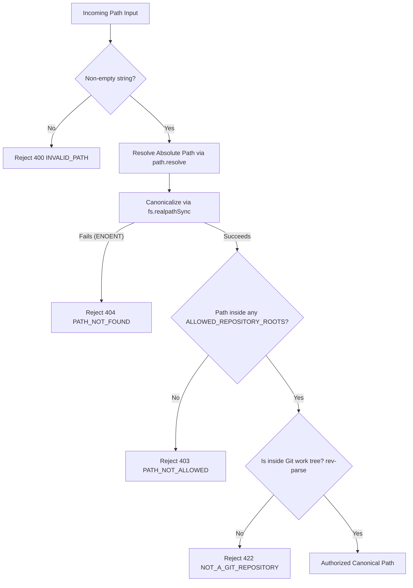

# GitScope Security Model & Hardening

GitScope is designed with a defense-in-depth, local-first security architecture. Because it operates on local Git repositories and executes local Git commands, protecting the host system from malicious repositories, path traversal, process injection, and denial of service is a core architectural requirement.

---

## 1. Threat Model

GitScope evaluates potential threats within the context of a local development environment:

| Threat Category                              | Potential Attack Vector                                                                                                          | Impact                                                                                                                  | GitScope Mitigation                                                                                                                                                                 |
| :------------------------------------------- | :------------------------------------------------------------------------------------------------------------------------------- | :---------------------------------------------------------------------------------------------------------------------- | :---------------------------------------------------------------------------------------------------------------------------------------------------------------------------------- |
| **Path Traversal & Filesystem Probing**      | Attempting to register arbitrary sensitive directories (e.g. `/etc`, `C:\Windows`, `~/.ssh`) or traversing via `../` / symlinks. | Unauthorized reading or metadata extraction of arbitrary host files.                                                    | Strict `ALLOWED_REPOSITORY_ROOTS` allowlist resolved via `fs.realpathSync`. Traversal sequences and uncanonicalized symlinks are rejected before disk access.                       |
| **Command & Argument Injection**             | Injecting shell metacharacters (`;&                                                                                              | `) or malicious Git flags (e.g. `--upload-pack=...`, `-o`, `--exec-path=...`) via repo paths, ref names, or file paths. | Arbitrary remote code execution (RCE) on the developer's machine.                                                                                                                   | `child_process.execFile` with fixed argument arrays. Zero shell interpolation. Strict Zod regex validation on refs, commit hashes, and file paths. |
| **Host Path Leakage**                        | Exposing sensitive local directory structures, usernames, or internal filesystem hierarchies in API error payloads.              | Information disclosure.                                                                                                 | Path scrubbing in all error responses and analysis logs; absolute paths matching `canonicalPath` are mapped to `[repo_root]`.                                                       |
| **Denial of Service (DoS)**                  | Analyzing repositories with pathological commit histories, hundreds of thousands of files in a single commit, or cyclic graphs.  | CPU starvation, memory exhaustion (OOM), locked databases.                                                              | Process timeouts (`GIT_COMMAND_TIMEOUT_MS`), output size caps (`MAX_GIT_OUTPUT_BYTES`), and combinatorial safety thresholds (`COCHANGE_MAX_FILES_PER_COMMIT`).                      |
| **Database Corruption & Inconsistent State** | Interrupted imports, unexpected process termination, or concurrent import attempts.                                              | Corrupted commit histories or orphaned records.                                                                         | Synchronous atomic transactions (`BEGIN IMMEDIATE`), foreign key cascades (`PRAGMA foreign_keys = ON`), and an in-memory lock preventing concurrent imports on the same repository. |

---

## 2. Repository Path Boundary Validation

All repository operations begin at the path validation boundary (`validateRepositoryPath` in `apps/api/src/git/repo-validator.ts`).



### Boundary Guarantees:

1. **Canonicalization**: Paths are converted using `fs.realpathSync.native()` to resolve all symlinks, Windows short names (8.3 filenames), and case discrepancies before checking against allowed roots.
2. **Symlink Escape Defense**: Symlinks pointing outside `ALLOWED_REPOSITORY_ROOTS` (even if the link itself is placed inside an allowed directory) resolve to their real target and are rejected with `PATH_NOT_ALLOWED`.
3. **Dash-Prefixed Names**: Repositories or folders named starting with dashes (e.g. `--upload-pack=exploit`) cannot be misinterpreted as CLI flags because arguments are passed strictly as discrete array elements to `execFile`.

---

## 3. Safe Process Execution

Git command execution is isolated in `apps/api/src/git/git-runner.ts`:

```typescript
// SECURE PATTERN: Argument array, no shell, pinned cwd, explicit timeouts
const result = await execFileAsync(
  'git',
  args, // e.g. ['log', '--topo-order', '--numstat']
  {
    cwd: canonicalPath,
    timeout: config.GIT_COMMAND_TIMEOUT_MS,
    maxBuffer: config.MAX_GIT_OUTPUT_BYTES,
    windowsHide: true,
  },
);
```

### Rules Enforced:

- **No Shell Execution**: `child_process.exec` and `{ shell: true }` are banned across the entire codebase.
- **Explicit Working Directory**: Every Git invocation explicitly binds `cwd` to the validated `canonicalPath`.
- **Bounded Buffers**: Output streams are capped at `MAX_GIT_OUTPUT_BYTES` (default: 50MB) to guard against unbounded memory consumption during diff generation.
- **Process Timeouts**: Every invocation is constrained by `GIT_COMMAND_TIMEOUT_MS` (default: 30s) to prevent hung processes from consuming OS resources.

---

## 4. Error Sanitization & Information Hiding

To prevent sensitive local filesystem paths from leaking into browser logs or network inspectors:

1. **Path Redaction**: All error messages generated during Git execution or database ingestion are scrubbed:
   ```typescript
   const sanitizedMessage = error.message.replace(canonicalPath, '[repo_root]');
   ```
2. **Standardized Error DTOs**: Unhandled 500 errors never return stack traces or internal module paths in production mode. Errors are mapped to standard error codes defined in `@gitscope/shared`:
   ```json
   {
     "error": {
       "code": "INTERNAL_SERVER_ERROR",
       "message": "An unexpected error occurred."
     }
   }
   ```
3. **Database Error Masking**: SQLite native errors (`SqliteError`) are intercepted and categorized as `DATABASE_ERROR` without exposing table schemas or query syntax.

---

## 5. Relational Integrity & Concurrency Control

### Foreign Key Constraints

SQLite foreign key enforcement is turned on explicitly for every connection:

```sql
PRAGMA foreign_keys = ON;
```

All child tables (`commit_parents`, `file_changes`, `refs`, `analysis_runs`) reference parent rows with `ON DELETE CASCADE`. Deleting a repository cleanly removes all associated historical data without orphan records.

### Concurrency Protection

To prevent race conditions during repository ingestion:

- An in-memory lock (`activeRuns: Set<string>`) tracks repositories currently undergoing analysis.
- Simultaneous `POST /api/repositories/:id/analyze` requests return HTTP `409 Conflict` (`ANALYSIS_ALREADY_RUNNING`).
- Database writes are executed within atomic transactions (`db.transaction(...)`). If an unexpected failure occurs mid-import, SQLite automatically rolls back the entire transaction.

---

## 6. Input Validation & Parameter Safety

- **Zero Dynamic SQL**: All database operations use SQLite parameterized statements (`?` placeholders). String interpolation into SQL statements is prohibited.
- **Schema Validation**: Every API route validates parameters, query strings, and request bodies using Zod schemas before reaching business logic.
- **Safe Graph Traversal**: The interactive commit graph uses depth-bounded recursive queries (`LIMIT 300`) to prevent infinite recursion on unusual branch topologies.
