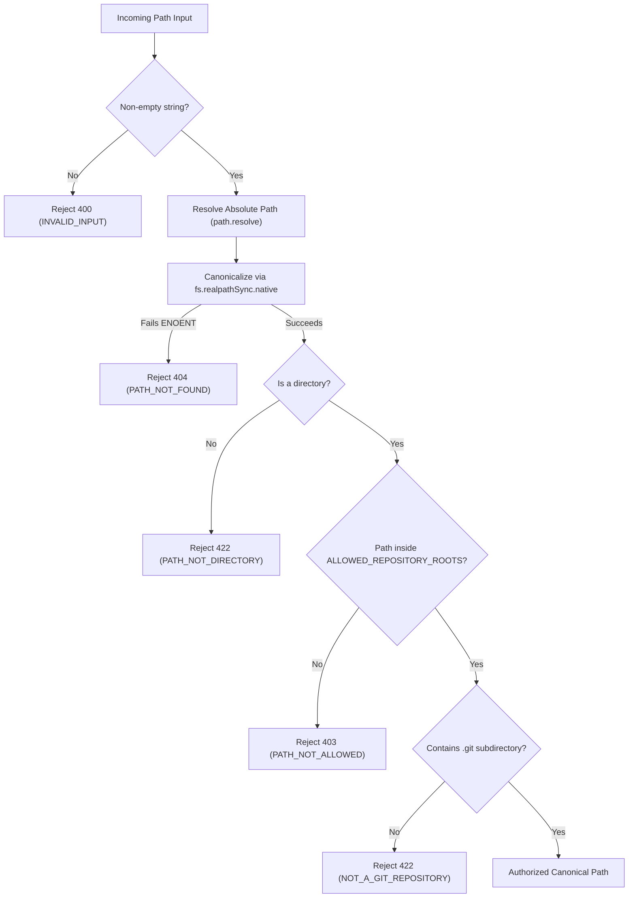

# GitScope Security Model & Hardening

GitScope is designed with a defense-in-depth, local-first security architecture. Because it operates on local Git repositories and executes local Git commands, protecting the host system from malicious repositories, path traversal, process injection, and denial of service is a core architectural requirement.

---

## 1. Threat Model

GitScope evaluates potential threats within the context of a local development environment:

| Threat Category                              | Potential Attack Vector                                                                                                                                                       | Potential Impact                                                     | GitScope Mitigation & Tested Controls                                                                                                                                                                                                                       |
| -------------------------------------------- | ----------------------------------------------------------------------------------------------------------------------------------------------------------------------------- | -------------------------------------------------------------------- | ----------------------------------------------------------------------------------------------------------------------------------------------------------------------------------------------------------------------------------------------------------- |
| **Path Traversal & Filesystem Probing**      | Attempting to register arbitrary sensitive directories (e.g. `/etc`, `C:\Windows`, `~/.ssh`) or traversing via `../` or symlinks.                                             | Unauthorized reading or metadata extraction of arbitrary host files. | Strict `ALLOWED_REPOSITORY_ROOTS` allowlist resolved via `fs.realpathSync.native()`. Traversal sequences and uncanonicalized symlinks are rejected before disk access. _(Verified in `security.test.ts` and `demo-repo.test.ts`)_.                          |
| **Command & Argument Injection**             | Injecting shell metacharacters (`;`, `&`, `\|`, `` ` ``) or malicious Git flags (e.g. `--upload-pack=...`, `-o`, `--exec-path=...`) via repo paths, ref names, or file paths. | Arbitrary remote code execution (RCE) on the developer's machine.    | `child_process.execFile` with discrete argument arrays. Zero shell interpolation (`shell: false`). Strict Zod validation on refs, commit hashes, and file paths. _(Verified in `runner.test.ts`)_.                                                          |
| **Host Path Leakage**                        | Exposing sensitive local directory structures, usernames, or internal filesystem hierarchies in API error payloads.                                                           | Information disclosure.                                              | Path scrubbing in error responses and analysis logs; absolute paths matching `canonicalPath` are sanitized to `[repo_root]`. _(Verified in `security.test.ts`)_.                                                                                            |
| **Denial of Service (DoS)**                  | Analyzing repositories with pathological commit histories, hundreds of thousands of files in a single commit, or cyclic graphs.                                               | CPU starvation, memory exhaustion (OOM), locked databases.           | Process timeouts (`GIT_COMMAND_TIMEOUT_MS`), output size caps (`MAX_GIT_OUTPUT_BYTES`), bounded graph depth (`LIMIT 300`), and combinatorial safety thresholds (`COCHANGE_MAX_FILES_PER_COMMIT`). _(Verified in `runner.test.ts` and `analytics.test.ts`)_. |
| **Database Corruption & Inconsistent State** | Interrupted imports, unexpected process termination, or concurrent import attempts.                                                                                           | Corrupted commit histories or orphaned records.                      | Synchronous atomic transactions (`db.transaction(...)`), foreign key cascades (`PRAGMA foreign_keys = ON`), and database concurrency guards rejecting simultaneous runs (`409 Conflict`). _(Verified in `importer.test.ts`)_.                               |

---

## 2. Repository Path Boundary Validation

All repository operations begin at the path validation boundary (`validateRepositoryPath` in `apps/api/src/git/path-validator.ts`).



### Boundary Guarantees:

1. **Canonicalization via `realpathSync`:** Paths are resolved using `fs.realpathSync.native()` to resolve all symlinks, Windows 8.3 short names, and case discrepancies before checking against allowed roots.
2. **Symlink Escape Defense:** Symlinks pointing outside `ALLOWED_REPOSITORY_ROOTS` (even if the symlink itself is located inside an allowed root) resolve to their target and are rejected with HTTP 403 (`PATH_NOT_ALLOWED`).
3. **Dash-Prefixed Names:** Directory names starting with dashes (e.g. `--upload-pack=exploit`) cannot be misinterpreted as CLI flags because arguments are passed strictly as discrete array elements to `execFile`.

---

## 3. Safe Process Execution

Git command execution is isolated in `apps/api/src/git/runner.ts`:

```typescript
// SECURE PATTERN: Argument array, no shell, pinned cwd, explicit timeouts
export async function runGit(args: string[], options: RunGitOptions): Promise<string> {
  const { cwd, timeoutMs, maxOutputBytes, signal } = options;

  return new Promise((resolve, reject) => {
    const child = execFile(
      'git',
      args, // Discrete array of strings: e.g. ['log', '--topo-order', '--numstat']
      {
        cwd,
        timeout: timeoutMs,
        maxBuffer: maxOutputBytes,
        windowsHide: true,
        signal,
        env: {
          ...process.env,
          GIT_TERMINAL_PROMPT: '0', // Suppress interactive password prompts
          LC_ALL: 'C', // Deterministic English locale output
        },
      },
      (error, stdout, stderr) => {
        // Sanitized error processing
      },
    );
  });
}
```

### Rules Enforced:

- **No Shell Execution:** `child_process.exec` and `{ shell: true }` are strictly forbidden across the codebase.
- **Explicit Working Directory:** Every Git invocation explicitly binds `cwd` to the validated `canonicalPath`.
- **Bounded Buffers:** Output streams are capped at `MAX_GIT_OUTPUT_BYTES` (default: 50MB) to guard against unbounded memory consumption during diff generation.
- **Process Timeouts:** Every invocation is constrained by `GIT_COMMAND_TIMEOUT_MS` (default: 30s) to prevent hung processes from consuming OS resources.
- **Prompt Suppression:** `GIT_TERMINAL_PROMPT=0` ensures Git immediately fails instead of hanging on unexpected authentication or credential prompts.

---

## 4. Error Sanitization & Information Hiding

To prevent sensitive local filesystem paths and system internals from leaking into browser logs or network inspectors:

1. **Path Redaction:** Error messages produced during Git CLI execution or database operations are scrubbed:
   ```typescript
   export function sanitizeErrorMessage(rawMessage: string, canonicalPath?: string): string {
     let sanitized = rawMessage;
     if (canonicalPath) {
       sanitized = sanitized.replaceAll(canonicalPath, '[repo_root]');
     }
     return sanitized;
   }
   ```
2. **Standardized Error DTOs:** Unhandled 500 errors never return stack traces or internal module paths in production mode. Errors are mapped to standard error codes defined in `@gitscope/shared`:
   ```json
   {
     "error": {
       "code": "INTERNAL_SERVER_ERROR",
       "message": "An unexpected error occurred."
     }
   }
   ```
3. **Database Error Masking:** SQLite native errors (`SqliteError`) are intercepted and returned as sanitized messages without exposing table schemas or raw SQL statements.

---

## 5. Relational Integrity & Concurrency Control

### Foreign Key Constraints

SQLite foreign key enforcement is turned on explicitly for every connection:

```sql
PRAGMA foreign_keys = ON;
```

All child tables (`commit_parents`, `file_changes`, `refs`, `analysis_runs`) reference parent rows with `ON DELETE CASCADE`. Deleting a repository cleanly purges all associated historical data without leaving orphaned records.

### Database Concurrency Guards

To prevent race conditions and concurrent write corruption during repository ingestion:

- A database-level check in `apps/api/src/routes/repositories.ts` inspects active runs:
  ```sql
  SELECT id FROM analysis_runs WHERE repo_id = ? AND status IN ('queued', 'running');
  ```
- If a run is already queued or active for that repository, simultaneous `POST /api/repositories/:id/analyze` requests are rejected with HTTP `409 Conflict` (`ANALYSIS_ALREADY_RUNNING`).
- Ingestion executes within atomic transactions (`db.transaction(...)`). If an unexpected failure occurs mid-import, SQLite automatically rolls back the entire transaction.

---

## 6. Input Validation & Parameter Safety

- **Zero Dynamic SQL:** All database operations use SQLite parameterized statements (`?` placeholders). String concatenation into SQL statements is strictly prohibited.
- **Zod Schema Validation:** Every API route validates parameters, query strings, and request bodies using Zod schemas before executing business logic.
- **Relative Path Sanitization:** File history endpoints sanitize file paths via `sanitizeRelativePath()`, rejecting traversal characters (`..`), drive letters (`C:`), or leading slashes before running queries.
- **Safe Graph Traversal:** The interactive commit graph uses depth-bounded recursive queries (`WHERE a.depth < 300`) to prevent infinite recursion on unusual branch topologies.

---

## 7. Remaining Limitations & Threat-Model Assumptions

1. **Single-User Workstation Assumption:** GitScope assumes it is executed on a workstation owned by the developer. It does not provide multi-tenant account isolation, authentication tokens, or role-based access control (RBAC).
2. **Localhost Network Boundary:** The API binds by default to `127.0.0.1` (`API_HOST`). Exposing the API to public or shared networks without an authenticating reverse proxy is not supported.
3. **Pathological Git Objects:** Repositories with corrupted packfiles or multi-gigabyte binary files can trigger execution timeouts or memory buffer limits; GitScope safely terminates these commands but will fail the analysis run with a sanitized error.
